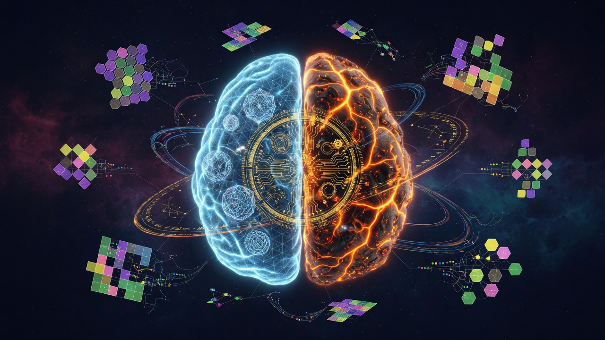

# megarexus

<p align="center">
  
</p>

**One brain. One repo. Operate here.**

**MegaMind** — Internal dreams · External judges · Central LoRA commits · operator garden pad.

| | |
|---|---|
| **Import** | `from brain import MegaMind` |
| **Primary docs** | [`docs/PRIMARY.md`](docs/PRIMARY.md) |
| **Pad status** | [`synthesis_lab/orchestration/rdl/brain/STATUS.md`](synthesis_lab/orchestration/rdl/brain/STATUS.md) |
| **Lab (not primary)** | [`docs/LAB.md`](docs/LAB.md) |
| **Mathematics** | [`docs/MATHEMATICS_OF_WORLD_CAPTURE.md`](docs/MATHEMATICS_OF_WORLD_CAPTURE.md) |

## Operate

```bash
# 1) Smoke — every planted idea on the pad
CUDA_VISIBLE_DEVICES= python -B synthesis_lab/orchestration/rdl/brain/smoke_all_ideas.py

# 2) Train flywheel — 24 games, level groups, keep-if-better
python -u -B synthesis_lab/orchestration/rdl/brain/train_flywheel.py \
  --root synthesis_lab/experiments/megamind_flywheel \
  --device cuda --max-cycles 0

# stop
touch synthesis_lab/experiments/megamind_flywheel/STOP
```

```python
from brain import MegaMind

mm = MegaMind(device="cpu")  # or "cuda"
state = mm.observe(frame)   # HxW color-index board
```

## Layout

```text
brain/                    # public API
docs/PRIMARY.md           # single source of truth
docs/assets/              # hero art
synthesis_lab/orchestration/rdl/brain/   # MegaMind implementation
  operators/              # Loom · Rexus · pattern growth · Weco RSI · …
  train_flywheel.py
  smoke_all_ideas.py
legal_search/algorithms/  # operator backends (source only)
codexlab/contra_head/     # CONTRA view backend
synthesis_lab/experiments/other_games/environment_files/  # 24-game suite
notes/                    # doctrine sweeps (+ archive/)
```

## Doctrine (short)

1. **One brain** — MegaMind only.  
2. Plant useful channels; training raises what works.  
3. **Multi-game level groups** — robust patterns, not one-game grind.  
4. **Keep only if better** on private multi-game metrics.  
5. Env grades only — no spill / win-bank / human-route train labels.

## Honesty

Specialist scorecard policies and legacy CNN experiments are **lab**, not the primary. See `docs/LAB.md`.
